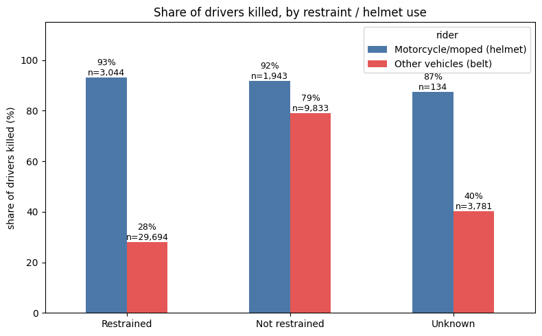
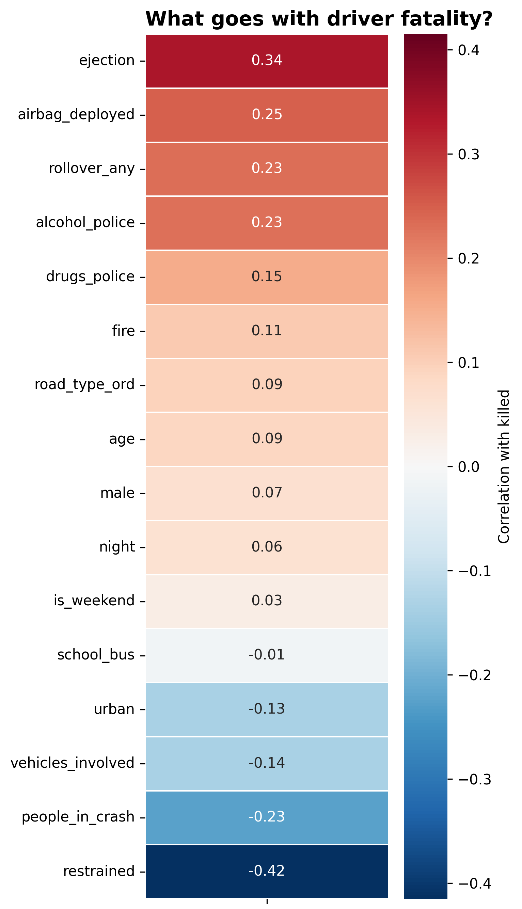
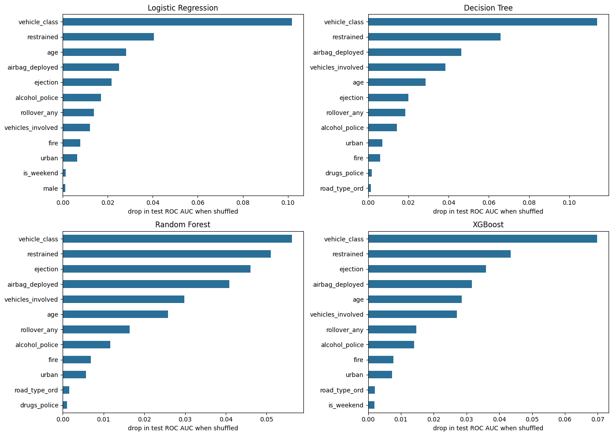
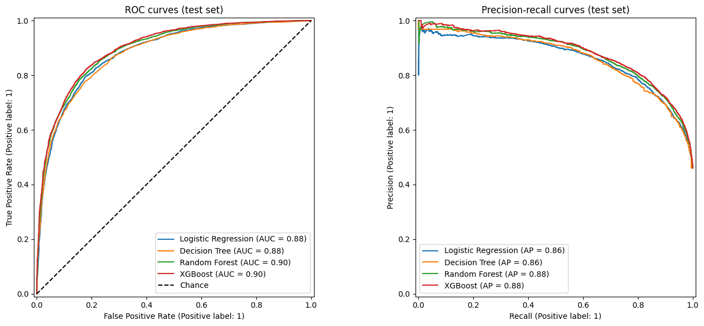
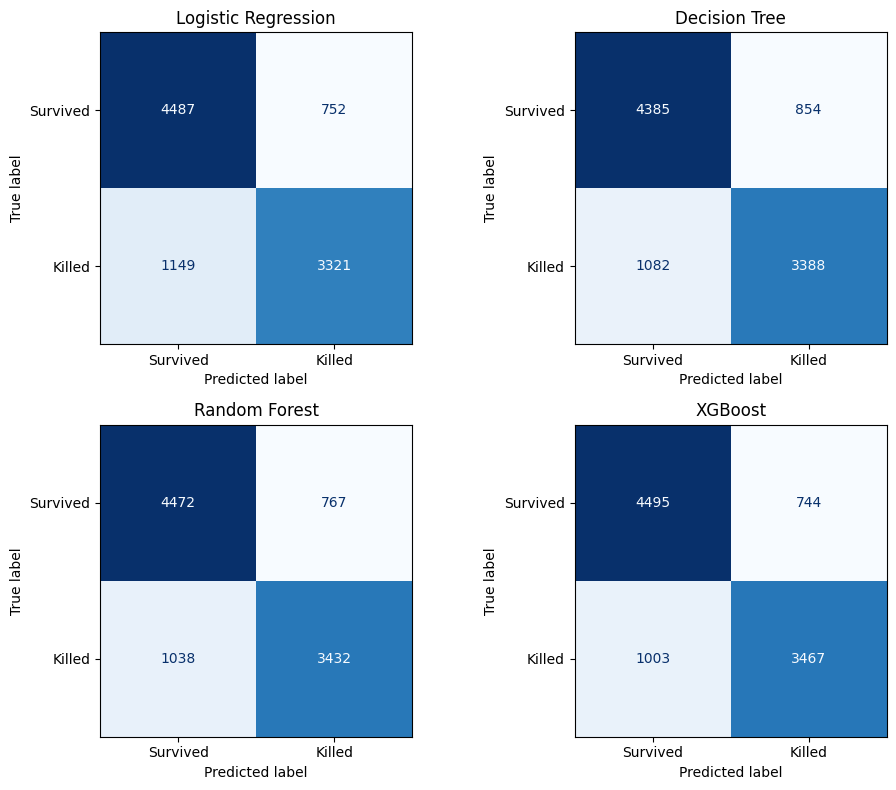

# Binary Classification of Driver Fatality Outcomes Using Logistic Regression, Decision Trees, Random Forests and XGBoost


A machine learning project that uses U.S. traffic-crash records from the **NHTSA Fatality Analysis Reporting System (FARS)** to predict whether a driver involved in a fatal crash was **killed or survived**, and to identify the factors most strongly associated with that outcome.

---

## Table of Contents

1. [Introduction](#introduction)
2. [Data Source and Acquisition](#data-source-and-acquisition)
3. [About the Data](#about-the-data)
4. [Methodology](#methodology)
5. [Key Findings](#key-findings)
6. [Model Performance](#model-performance)
7. [Why This Project Is Useful](#why-this-project-is-useful)
8. [Limitations](#limitations)
9. [Repository Structure](#repository-structure)
10. [How to Reproduce](#how-to-reproduce)
11. [Future Work](#future-work)
12. [Author](#author)
13. [Acknowledgements and Data Citation](#acknowledgements-and-data-citation)

---

## Introduction

Road traffic crashes remain a leading cause of preventable death. Understanding which circumstances separate a driver who survives a serious crash from one who does not can inform road-safety policy, vehicle design priorities and public awareness campaigns.

This project asks a focused question:

> **Given the characteristics of a driver and the crash they were involved in, can we predict whether the driver was killed?**

To answer it, I cleaned and explored person-level FARS records, engineered features, and compared four supervised classification models: **Logistic Regression**, **Decision Tree**, **Random Forest** and **XGBoost**. The exploratory analysis covers who is killed and when, vehicle type, restraint and helmet use, and alcohol and drug involvement. Because alcohol and drug test results exist mostly for drivers who died, they are analysed but deliberately kept out of the models (see [Limitations](#limitations)).

---

## Data Source and Acquisition

| Item | Detail |
|---|---|
| **Source** | National Highway Traffic Safety Administration (NHTSA), Fatality Analysis Reporting System (FARS) |
| **Access method** | Google BigQuery public dataset `nhtsa_traffic_fatalities` |
| **Table used** | Person-level table for the year **2015** (`person_2015`) |
| **Extraction** | SQL query in BigQuery selecting 30 columns, exported to CSV and loaded into a Python (pandas) environment |
| **Raw size** | 81,620 rows x 30 columns |
| **Coverage** | United States, calendar year 2015 |

FARS is a nationwide census of fatal motor-vehicle crashes on public roads, compiled by NHTSA from police crash reports, state records, death certificates and other official sources. Variable definitions and coding were taken from the official **FARS Analytical User's Manual**; the codes used in this project are listed in [`fars_code_reference.txt`](fars_code_reference.txt).

---

## About the Data

Each row in the person-level table represents **one person involved in a fatal crash** (drivers, passengers, pedestrians, cyclists and others). Columns describe the person (age, sex, role, restraint use, ejection, injury severity), the vehicle and crash circumstances (vehicle body type, rollover, first harmful event, road type), and alcohol and drug test indicators. The 81,620 rows belong to 32,538 crashes.

**How the population was narrowed for modelling:**

| Step | People |
|---|---:|
| All person records | 81,620 |
| Known injury outcome (KABCO codes 0 to 4) | 80,571 |
| **Drivers only, known outcome** | **48,429** |
| of whom killed | 22,350 (46.2%) |

Records with an unknown outcome (injured with unknown severity, died prior to the crash, or unknown) were removed. FARS codes for "not reported", "unknown" and "not applicable" were set to missing before any analysis.

**Engineered features:**

- `death_per_crash`: the number of deaths in a crash divided by the number of people involved, as a decimal. It is used only in exploratory analysis. Because it is built from the outcome, it is excluded from the model features.
- Grouped features: vehicle class (car, SUV, van, pickup, bus, heavy truck, motorcycle/moped, other), restrained / not restrained, airbag deployed / not deployed, any rollover, night-time crash (22:00 to 05:59), and an ordered ejection scale.

**Target variable:** a binary label, **killed (1)** vs **not killed (0)**, where killed means KABCO injury code 4 (fatal injury).

---

## Methodology

1. **Data extraction:** SQL query in Google BigQuery.
2. **Data cleaning:** whitespace and empty strings, FARS unknown / not-reported codes, data types, duplicate check.
3. **Exploratory data analysis (EDA):** outcome rates by age, sex, person type, month, weekday and hour; crash-level counts; vehicle class; restraint and helmet use; alcohol and drug analysis.
4. **Correlation analysis:** heatmap of driver-level variables against the fatality outcome.
5. **Feature preparation:** encoding of categorical variables, vehicle-class dummies (Car as the reference group), and removal of fields that are built from, or depend on, the outcome (`death_per_crash`, `bac`, `any_drug_found`) plus the crash-level count `people_in_crash`.
6. **Train/test split:** 80/20 split **grouped by crash** (`GroupShuffleSplit`, `random_state=42`), so drivers from the same crash never appear on both sides. The notebook checks that no crash is in both sets.
7. **Modelling:** Logistic Regression, Decision Tree, Random Forest and XGBoost, each as a pipeline of median imputation with missing-value flags (plus scaling for logistic regression).
8. **Hyperparameter tuning:** `RandomizedSearchCV` with 30 random combinations per model, 3-fold CV grouped by crash, scored on ROC AUC, run on the training set only.
9. **Evaluation:** accuracy, precision, recall, F1-score, ROC AUC, confusion matrices, ROC and precision-recall curves, permutation feature importance, and logistic regression coefficients.
10. **Model persistence:** all four fitted pipelines and the expected feature-column list saved as pickle files.

**Tools:** Python, pandas, NumPy, scikit-learn, XGBoost, SciPy, Matplotlib / Seaborn, Jupyter Notebook, SQL, Google BigQuery.

---

## Key Findings

All figures below are for the 2015 FARS data and describe associations among people who were already in fatal crashes. They do not establish causation.

### Who is killed, when and in what

- **About 46% of drivers with a known outcome were killed** (22,350 of 48,429), so the classes are reasonably balanced and accuracy is a meaningful, though not sole, metric.
- **Road users:** across all 80,571 people with a known outcome, 92.9% of pedestrians and 95.8% of bicyclists were killed, against 46.2% of drivers and 26.3% of passengers.
- **Age and sex:** the share killed is about 19% for ages 0 to 14, 44% for ages 21 to 29, 50% for ages 50 to 59 and 73% for ages 80 and over. Men made up 66% of people in the data and 47.6% of them were killed, against 38.4% of women.
- **Time:** Saturday, Sunday and Friday have the most fatal crashes. Crashes peak in the early evening, but the *share* of people killed is highest after midnight. The share killed barely moves by month (43.1% to 45.1%).
- **Vehicle class (drivers):** motorcycle and moped drivers were killed 92.5% of the time, cars 47.9%, pickups 40.6%, SUVs 38.9%, vans 32.2%, heavy trucks 15.0% and buses 6.2%.

### Restraint and helmet use

Restraint use is the strongest single correlate of driver fatality (correlation with `killed` of -0.42, the largest in the heatmap) and the second most important feature in all four models.

| Restraint group (drivers) | Drivers | Share of drivers | Share killed |
|---|---:|---:|---:|
| Restrained (belt, child seat or helmet) | 32,738 | 67.6% | 34.1% |
| Not restrained | 11,776 | 24.3% | 81.1% |
| Unknown | 3,915 | 8.1% | 41.7% |

- **Belts:** in cars, SUVs, vans, pickups and trucks, 28% of belted drivers were killed against 79% of unbelted drivers.
- **Helmets:** motorcycle and moped drivers were killed at almost the same rate with and without a helmet (93% vs 92%; by raw code, DOT-compliant helmet 92.8% against no helmet 91.1%). **This does not show that helmets do not work.** FARS only includes crashes in which someone died, and in a single-vehicle motorcycle crash that person is usually the rider, so nearly every rider in the file died regardless of helmet use. The data cannot measure helmet protection.


- **Unknown restraint** is spread similarly across outcomes (8.7% of surviving and 7.3% of killed drivers), unlike alcohol test results, so it is treated as an ordinary missing value.

### Alcohol

- A BAC reading exists for only **49% of drivers (23,842)**, and testing depends on the outcome: **73.5% of killed drivers were tested against 28.4% of survivors**. Every alcohol figure below describes *tested drivers only* and is selection-biased.
- Among tested drivers, the share killed was 64.5% at BAC 0.00, 71.7% at 0.01 to 0.079, 67.1% at 0.08 to 0.149 and **84.1% at 0.15 or higher** (4,510 drivers). The rise is not steady across bands, which is another sign of the testing effect.


- Tested drivers with any alcohol were killed 77.6% of the time against 64.5% without (odds ratio 1.90, 95% CI 1.78 to 2.02). The 0.00 group is itself high because most tested drivers are drivers who died.
- Among tested drivers, the share at or above 0.08 is highest between midnight and 04:00, for both killed (64.3%) and surviving (45.1%) drivers.

### Drugs

- Drug testing is also outcome-dependent: **71.5% of tested drivers were killed against 27.3% of untested drivers.**
- Among the 20,084 tested drivers, the share killed was 70.3% for a negative result and 72% to 83% for the identified drug categories (cannabinoid 72.4%, narcotic 77.1%, multiple drug types 77.0%, stimulant 81.9%, other drug 82.6%, depressant 83.1%). Drivers with a positive result of unknown type were killed 69.8% of the time. The gap between negative and positive results is much smaller than the gap created by who gets tested.

### Models and feature importance

- **Best-performing model:** tuned **XGBoost**, with **82.0% accuracy**, an **F1-score of 0.799** and a **ROC AUC of 0.900** on the held-out test set. It leads on every metric, though the margin over the other models is small (see below).
- **Most influential features** (permutation importance, drop in test ROC AUC): **vehicle class** is first and **restraint use** second in all four models. After that, ejection, airbag deployment, age and number of vehicles involved appear near the top for the tree-based models. Rollover and police-reported alcohol involvement follow.




- **Logistic regression is competitive.** Its ROC AUC (0.884) is within 0.016 of XGBoost, so most of the signal is captured by a simple, interpretable model.

---

## Model Performance

Metrics on the held-out test set (9,709 drivers from crashes the models never saw), after hyperparameter tuning. The positive class is "killed".

| Model | Accuracy | Precision | Recall | F1-score | ROC AUC |
|---|---:|---:|---:|---:|---:|
| Logistic Regression | 0.804 | 0.815 | 0.743 | 0.777 | 0.884 |
| Decision Tree | 0.801 | 0.799 | 0.758 | 0.778 | 0.882 |
| Random Forest | 0.814 | 0.817 | 0.768 | 0.792 | 0.896 |
| **XGBoost** | **0.820** | **0.823** | **0.776** | **0.799** | **0.900** |

**Effect of tuning (ROC AUC, default to tuned):** Decision Tree 0.737 to 0.882, Random Forest 0.873 to 0.896, XGBoost 0.897 to 0.900, Logistic Regression unchanged at 0.884. The untuned decision tree overfitted badly (train AUC 1.000); tuning brought it close to the others.

**Overfitting check (train vs test ROC AUC, tuned models):** Logistic Regression 0.882 vs 0.884, Decision Tree 0.899 vs 0.882, Random Forest 0.926 vs 0.896, XGBoost 0.912 vs 0.900. The gap is largest for Random Forest (0.030) and smallest for Logistic Regression and XGBoost.

*Metrics come from a single grouped train/test split, so differences of a point or two between models should not be over-read.*


| Model | Version | Accuracy | Precision | Recall | F1-score | ROC AUC | Train AUC |
|---|---|---:|---:|---:|---:|---:|---:|
| Decision Tree | Baseline | 0.735 | 0.714 | 0.709 | 0.711 | 0.737 | 1.000 |
| Decision Tree | Tuned | 0.801 | 0.799 | 0.758 | 0.778 | 0.882 | 0.899 |
| Logistic Regression | Baseline | 0.804 | 0.816 | 0.743 | 0.778 | 0.884 | 0.882 |
| Logistic Regression | Tuned | 0.804 | 0.815 | 0.743 | 0.777 | 0.884 | 0.882 |
| Random Forest | Baseline | 0.793 | 0.778 | 0.771 | 0.774 | 0.873 | 0.999 |
| Random Forest | Tuned | 0.814 | 0.817 | 0.768 | 0.792 | 0.896 | 0.926 |
| XGBoost | Baseline | 0.817 | 0.816 | 0.778 | 0.797 | 0.897 | 0.927 |
| XGBoost | Tuned | 0.820 | 0.823 | 0.776 | 0.799 | 0.900 | 0.912 |





---

## Why This Project Is Useful

- **Highlights risk factors worth targeting.** Ranking the variables most associated with driver death (vehicle class, restraint use, ejection, airbag deployment, age) gives road-safety teams evidence for prioritising awareness campaigns and enforcement.
- **Informs policy and planning.** Transport agencies, insurers and public-health analysts can use the factor rankings as a starting point for deeper, causal studies.
- **Shows how selection bias distorts safety data.** The alcohol, drug and helmet analyses document how conditioning on fatal crashes, and on who gets tested, can produce misleading headline numbers.
- **Compares models on real-world data.** It contrasts an interpretable baseline (Logistic Regression) with ensemble methods (Random Forest, XGBoost), showing that the extra complexity buys a modest gain.
- **Provides a reproducible template.** The workflow runs from cloud data extraction (BigQuery) through cleaning, EDA, tuning, evaluation and model persistence, and can be reused for other binary classification problems.
- **Offers a foundation to build on.** The cleaned pipeline can be extended to additional FARS years, other road-user types or richer feature sets.

---

## Limitations

### Limitations of the dataset

- **Fatal crashes only.** FARS includes only crashes in which at least one person died within 30 days. Non-fatal crashes are absent, so this dataset cannot support conclusions about crash *risk* in general. The model predicts who died *among people already in fatal crashes*, which is a form of **selection bias**. It is most visible for motorcycle riders (92.5% killed) and for helmet use.
- **Single year.** Only 2015 data is used. Patterns may differ in other years due to changes in vehicle safety technology, legislation, driving behaviour and reporting practices.
- **United States only.** Road infrastructure, laws, vehicle fleets and driver populations differ elsewhere, limiting generalisability beyond the U.S.
- **Missing and "unknown" values.** Many fields contain unknown, not-reported or not-applicable codes. They were set to missing and imputed for modelling, which may bias results if missingness is not random.
- **Alcohol and drug data depend on who was tested.** Only 49% of drivers have a BAC reading, and killed drivers were tested far more often than survivors. Substance involvement is likely under-reported, test results indicate presence rather than impairment at the time of the crash, and all alcohol and drug rates in this project describe tested drivers only. For the same reason `bac` and `any_drug_found` were excluded from the models.
- **Some features carry outcome information through missingness.** `ejection` and `airbag_deployed` are missing mostly for motorcycles, which is structural. Police-reported alcohol and drug involvement are also missing more often for killed drivers (by about 16 and 14 percentage points), and vehicle type does not explain this. These features were kept, with missing-value flags, so their importance should be read with care. The notebook ends section 10 with a sensitivity check that retrains each tuned model without them.
- **Reporting inconsistencies.** Data is compiled from police reports and state systems, so coding practices and data quality vary by jurisdiction.
- **Limited vehicle and environmental detail.** The selected 30 columns omit factors such as vehicle speed at impact, vehicle model year and safety features, road design, and emergency response time, all of which influence survival.

### Limitations of the project

- **Prediction is not causation.** Associations and feature importances show which variables relate to the outcome, not that they cause it. Airbag deployment, for example, correlates positively with death, most likely because airbags deploy in severe crashes.
- **Restraint grouping.** The `restrained` feature combines belts, child seats and helmets into one group. Vehicle class carries the motorcycle distinction.
- **Outcome definition.** The "killed vs not killed" label simplifies a spectrum of injury severity into two classes, losing nuance.
- **Drivers only.** Passengers, pedestrians and cyclists were excluded from modelling, so findings do not apply to them.
- **Scope of the 30-column extract.** The feature set was limited by the columns selected and may exclude informative variables.
- **Feature-engineering choices.** Decisions on encoding, handling of unknowns and feature removal affect results and were made under practical constraints.
- **Model tuning limits.** Hyperparameter search used 30 random combinations per model; a wider search or additional model families (e.g. other gradient-boosting variants, neural networks) might improve performance.
- **One split, no confidence intervals.** Metrics come from a single grouped train/test split, so small differences between models are within what a different split could change.
- **Not validated externally.** Models were evaluated on a split of the same 2015 data, not on other years or independent data, so real-world performance may be lower.
- **Not for operational use.** This is an educational and portfolio project. It should **not** be used for insurance, legal, medical or policy decisions.

---

## Repository Structure

```
.
├── README.md
├── FARS.ipynb                 # Full analysis notebook: cleaning, EDA, modelling
├── fars_code_reference.txt    # Meaning of the numeric codes used in the 30-column extract
├── data/                      # Data files or extraction instructions (see note below)
├── models/                    # Saved pickle files for all four tuned models
├── images/                    # Charts used in this README, taken from the notebook outputs
├── sql.txt/                       # BigQuery extraction query
└── requirements.txt
└── 2015 FARS GES Coding and Validation Manual.pdf
```

The notebook writes the pickle files to `models/` and two drug-test charts and two correlation heatmaps to its working folder. The charts in `images/` were exported from the notebook's saved outputs.

---

## How to Reproduce

1. **Clone the repository**

   ```bash
   git clone https://github.com/Pntiamoah27/fars-fatality-prediction.git
   cd fars-fatality-prediction
   ```

2. **Install dependencies**

   ```bash
   pip install -r requirements.txt
   ```

3. **Obtain the data**
   - Query the BigQuery public table [`bigquery-public-data.nhtsa_traffic_fatalities.person_2015`](https://console.cloud.google.com/bigquery?p=bigquery-public-data&d=nhtsa_traffic_fatalities&t=person_2015&page=table) for the 30 columns used (see `sql/`), export the result as `fars data.csv` and place it next to the notebook, or
   - Use the extract provided in `data/` if included.

4. **Run the notebook**

   ```bash
   jupyter notebook FARS.ipynb
   ```

   Run it top to bottom. The tuning cell takes a while because the search grids are wide.

5. **Load a saved model**

   ```python
   import pickle

   with open("models/xgboost.pkl", "rb") as f:
       model = pickle.load(f)
   with open("models/feature_columns.pkl", "rb") as f:
       feature_columns = pickle.load(f)

   # new_X: drivers encoded exactly as in the notebook (same mappings and dropped columns)
   probability_killed = model.predict_proba(new_X[feature_columns])[:, 1]
   ```

   The other files are `logistic_regression.pkl`, `decision_tree.pkl` and `random_forest.pkl`. Each file is a full pipeline, so missing values are imputed automatically.

---

## Future Work

- Add further FARS years to test whether the findings and model performance hold over time.
- Extend the models to passengers, pedestrians and cyclists.
- Combine FARS with non-fatal crash data (for example NHTSA's GES / CRSS) to study crash *risk* rather than survival within fatal crashes, which would also allow helmet and belt effects to be estimated properly.
- Add speed, road design, vehicle age and safety-feature variables.
- Model injury severity on the full KABCO scale instead of a binary label.
- Try wider hyperparameter searches, calibration and SHAP-based explanations.

---

## Author

**Prince**
Data Analyst | Aspiring Data Scientist
Google Advanced Data Analytics Professional Certificate

- GitHub: [Prince Ntiamoah](https://github.com/Pntiamoah27)
- LinkedIn: [Prince Ntiamoah](https://www.linkedin.com/in/prince-ntiamoah-27186a20a)

---

## Acknowledgements and Data Citation

- National Highway Traffic Safety Administration (NHTSA), *Fatality Analysis Reporting System (FARS)*, U.S. Department of Transportation.
- Data accessed through the Google BigQuery public dataset program.
- NHTSA *FARS Analytical User's Manual* for variable definitions and coding.

*This project is for educational and portfolio purposes and is not affiliated with or endorsed by NHTSA or the U.S. Department of Transportation.*
